:::tip[Truy cập nhanh]
Liên kết tải Minecraft: Java Edition cho Windows
- Minecraft Launcher: ([Windows 10/11](https://aka.ms/minecraftClientGameCoreWindows), [Windows XP/7/8/8.1](https://aka.ms/minecraftClientWindows), [Microsoft Store](https://www.xbox.com/en-US/games/store/minecraft-launcher/9pgw18npbzv5))
- Legacy Launcher: ([Installer](https://llaun.ch/en)/[Portable](https://llaun.ch/portable))
- MultiMC: ([Windows](https://files.multimc.org/downloads/mmc-develop-win32.zip))
:::

**Minecraft** là trò chơi điện tử sandbox được phát triển và phát hành bởi Notch, nhà sáng lập của Mojang Studio. Minecraft dần trở nên phổ biến và trở thành một trong những trò chơi điện tử thành công nhất mọi thời đại. Tính đến thời điểm này, Minecraft được bán trên trang chủ với giá ***$29.99***. Trong bài hướng dẫn này, mình sẽ hướng dẫn chi tiết cho các bạn cách tải Minecraft trên 2 nền tảng phổ biến là Windows và Android.

## Java Edition và Bedrock Edition là gì?

- ***Minecraft: Java Edition*** là phiên bản đầu tiên của Minecraft, được tạo ra bằng ngôn ngữ lập trình Java vào năm 2009 và phát hành chính thức vào 2011 cho hệ máy Windows, MacOS. 

- ***Minecraft: Bedrock Edition*** (trước đây là **Pocket Edition**) là bản Port của Minecraft cho thị trường Android và iOS vào năm 2011 được tạo ra bằng ngôn ngữ lập trình C++ do iOS không hỗ trợ Java, tuy nhiên bị thiếu khá nhiều tính năng so với bản PC. Tháng 12 năm 2014, một bản port của Windows Phone 8.1 được ra mắt sau thương vụ Microsoft mua lại Mojang từ Notch. Năm 2017, sau cập nhật "Better Together Update", tất cả phiên bản Pocket Edition và Console Edition lần lượt hợp nhất và đổi tên thành Bedrock Edition, cho phép chơi đa nền tảng giữa các thiết bị trên.

## Hướng dẫn tải Minecraft Java Edition trên thiết bị Windows

### 1. Tải từ nguồn chính thức.

:::important[Quan trọng]
Minecraft là tựa game có phí, để mua Minecraft và chơi trên Trình khởi động chính thức của trò chơi cũng như các máy chủ bản quyền (Hypixel, Mineplex,...) và nhận được sự hỗ trợ chính thức từ Mojang, hãy [nhấp vào đây](https://www.minecraft.net/en-us/store/minecraft-java-bedrock-edition-pc?tabs=%7B%22details%22%3A0%7D).
:::

##### **Cách 1:** Tải từ trang chủ Minecraft.net
###### **Bước 1**: Truy cập website *[tại đây](https://www.minecraft.net/en-us/download)* nếu bạn đã mua game rồi.

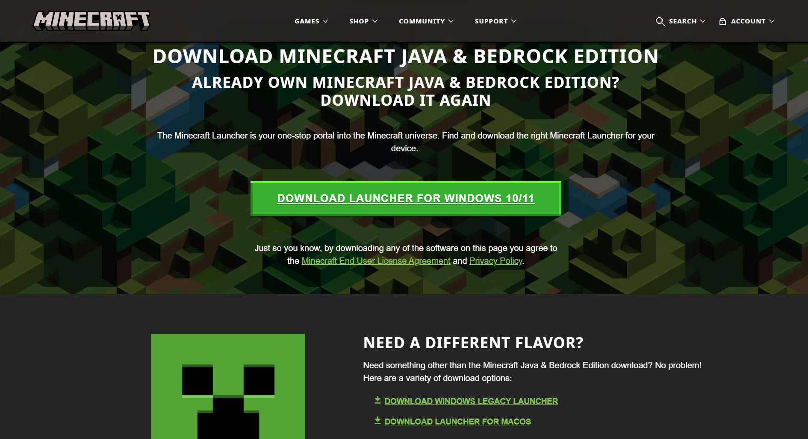

Chọn phiên bản tương ứng với hệ điều hành bạn đang sử dụng:
- Nếu dùng **Windows 10/11**: Chọn **Download Launcher for Windows 10/11**.
- Nếu dùng **Windows 8.1, 8 hoặc 7**: Chọn **Download Windows Legacy Launcher**.

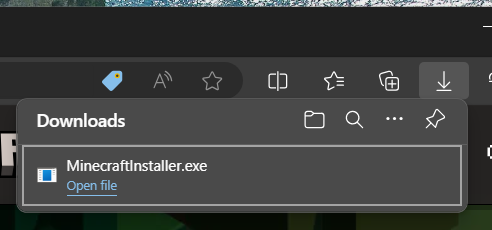

Đợi quá trình tải xuống hoàn tất, khởi chạy tập tin MinecraftInstaller.exe và làm theo hướng dẫn. 

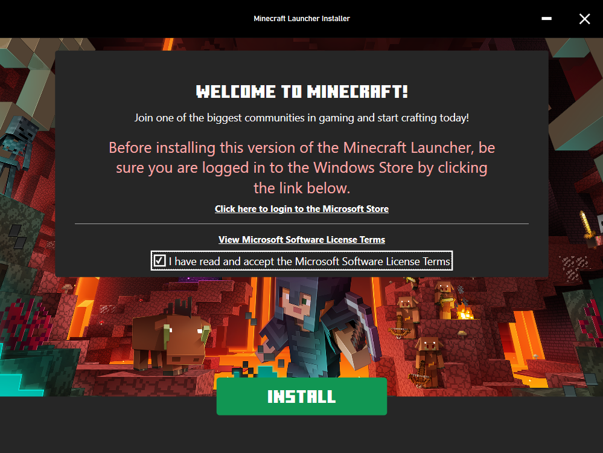

###### **Bước 2:** **Chấp nhận Điều khoản dịch vụ** và ấn **Install**

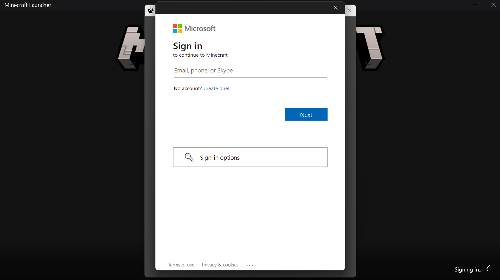

Đến đoạn này, hãy đăng nhập tài khoản Xbox của bạn vào.

### 2. Tải Launcher bên thứ ba.

:::note[Lưu ý]
Một số Trình khởi động (Launcher) bên thứ ba cho phép bạn chơi Minecraft miễn phí mà không cần mua trò chơi, tuy nhiên một vài trong số đó có thể chứa mã độc/mã theo dõi. Hãy lưu ý khi sử dụng, và hãy tìm các nguồn uy tín để tải về. Mọi vấn đề sau này mình sẽ không chịu trách nhiệm.
:::
#### 1. Legacy Launcher
:::tip[Mẹo]
Legacy Launcher được biết đến là trình khởi động nhẹ, tích hợp hệ thống skin của Ely.by, có thể hoạt động tốt kể cả trên Windows XP, 7. Mình khuyến khích các bạn sử dụng Launcher này.
:::

###### **Bước 1**: Truy cập website của *Legacy Launcher* *[tại đây](https://llaun.ch/en)*

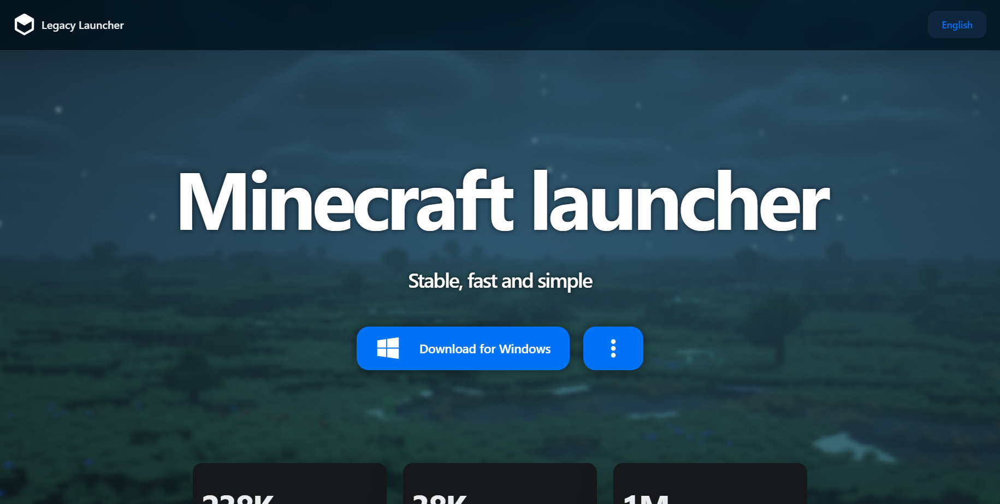

Nhấn vào ***Download for Windows*** để bắt đầu tải về.
Hoặc các bạn có thể tải nhanh tại [đây](https://llaun.ch/installer) ([Portable](https://llaun.ch/portable))

###### **Bước 2**: Làm theo các bước cài đặt Legacy Launcher vào máy

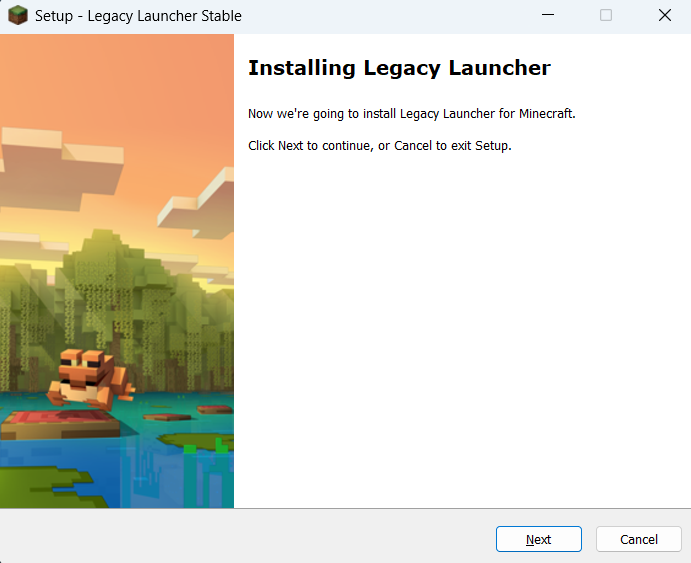

###### **Bước 3**: Nhấp chuột vào Finish để hoàn tất cài đặt, Legacy Launcher sẽ tự khởi động sau đó.

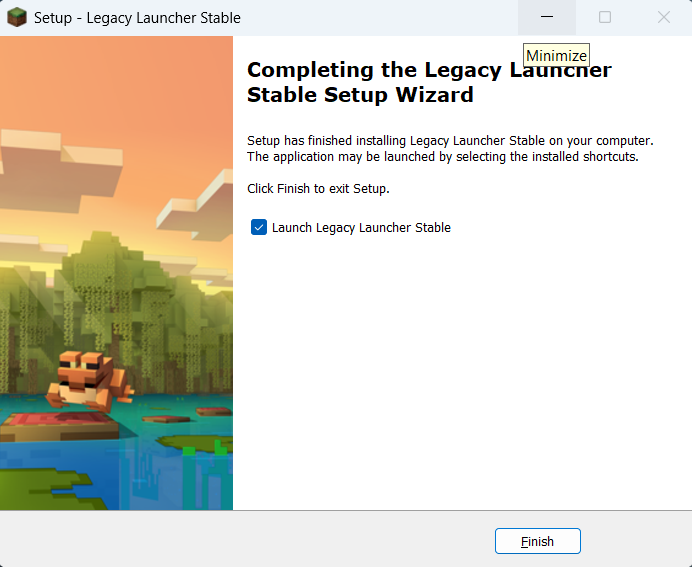

###### **Bước 4**: Đợi thanh nạp đến 75%, chọn **tiếng Việt** (vi_VN) và nhấn OK

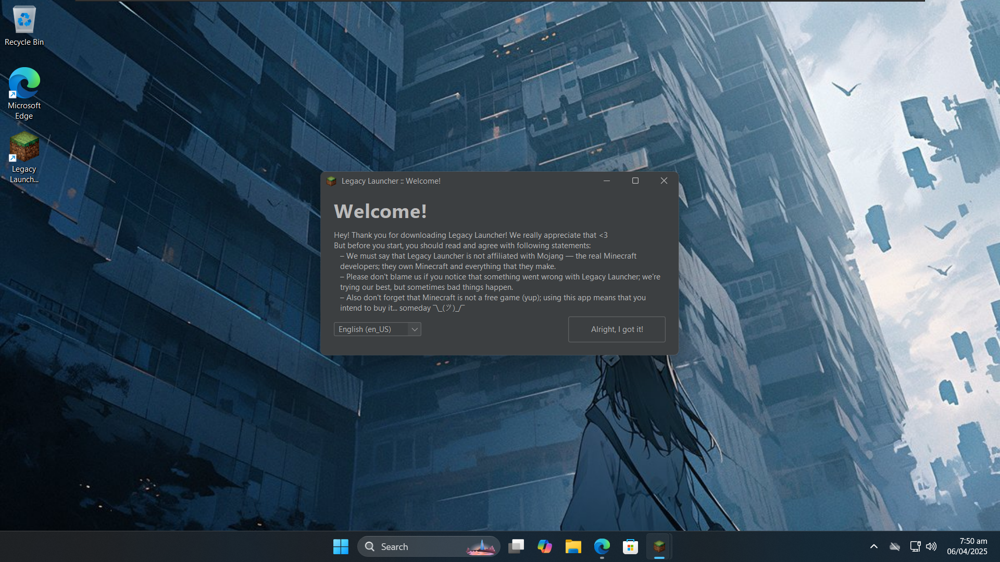

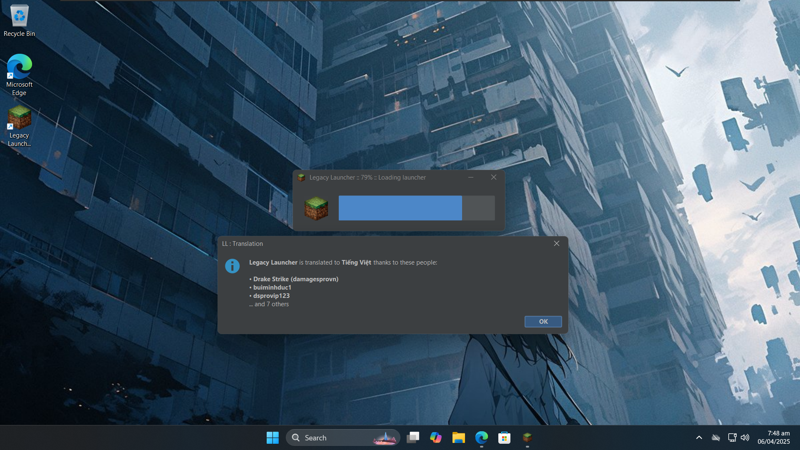

###### **Bước 5**: Giao diện của LLauncher mở ra, nhấn vào dấu 3 gạch và chọn **"Quản lí tài khoản"**

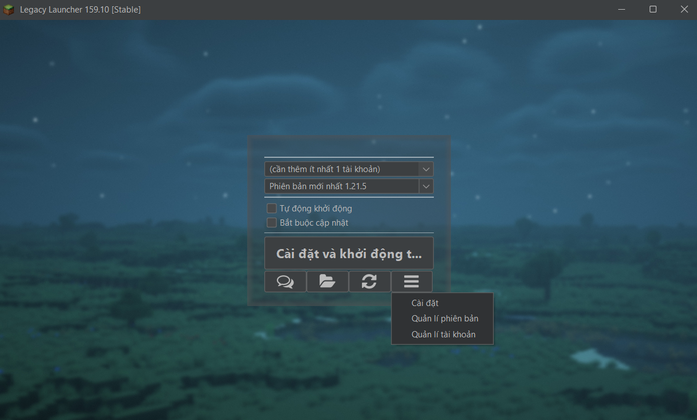

Ấn vào **(+)** để thêm tài khoản

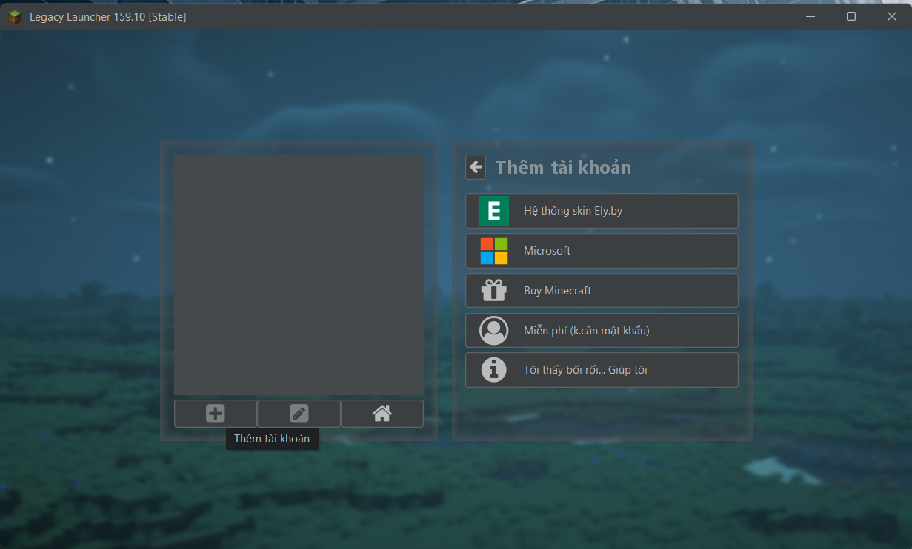

:::tip[Mẹo]
Nếu đây là lần đầu bạn chơi Minecraft hoặc lần đầu chơi Minecraft trên PC, hãy ấn vào **"Miễn phí"** để tạo tài khoản miễn phí.
Ngoài ra cũng có các tuỳ chọn khác như:
- **Hệ thống skin Ely.by**: giúp bạn đổi skin trong game mà không phải dùng skin mặc định. Tham khảo bài viết này để đổi skin trên Ely.by.
- **Microsoft**: đăng nhập tài khoản Minecraft bản quyền và chơi ngay trên LLauncher.
:::

Nhập tên người dùng bạn muốn đặt và ấn ***"Thêm tài khoản"***.

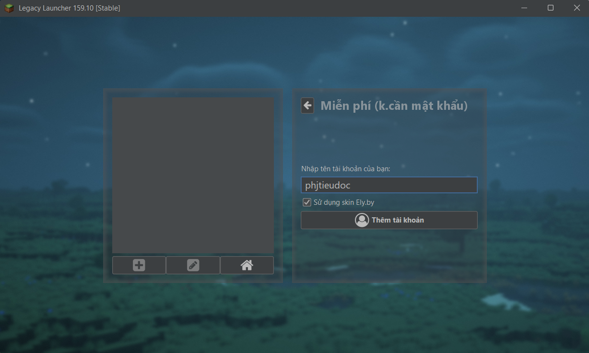

Quay về màn hình chính và ấn ***"Cài đặt và khởi động"***. LLauncher sẽ mặc định vào game trong phiên bản phát hành mới nhất.

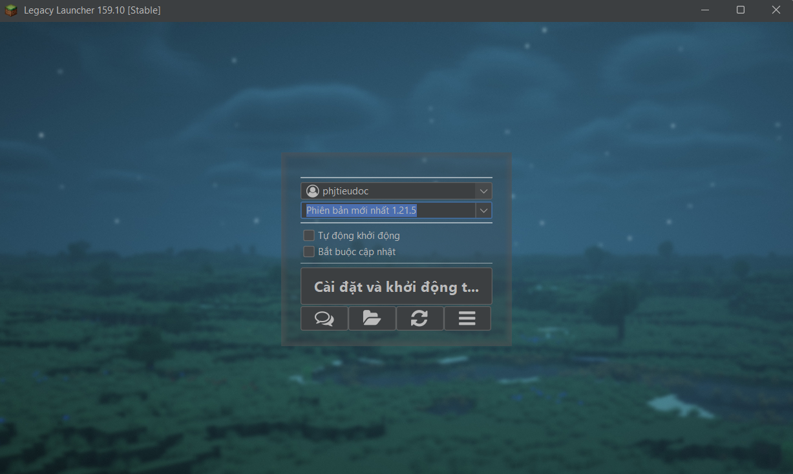
